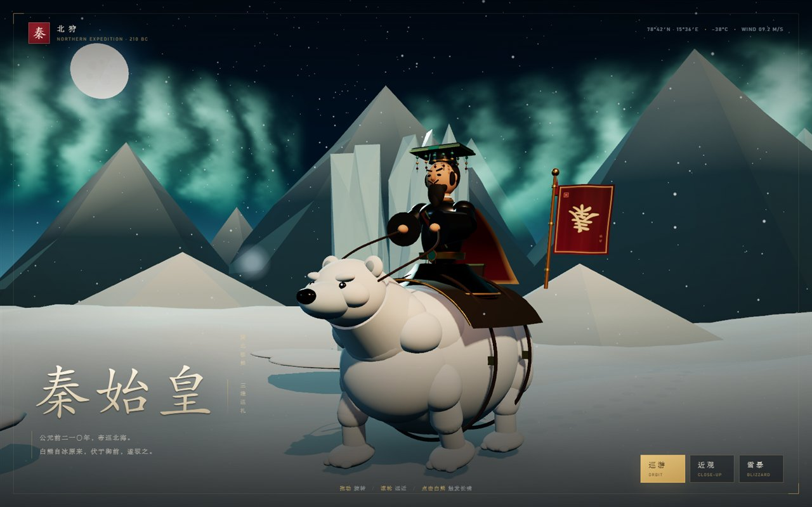
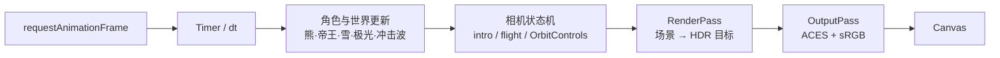

# 北狩 · 秦始皇骑北极熊

> 极夜、极光、风雪与冰原之上，帝骑白熊北巡。



一个纯前端、零构建的 Three.js 3D 互动网页。白熊、帝王、冕旒、鞍具、旗帜与冰原全部由代码程序化生成，不依赖外部模型、贴图或在线资源；Three.js 已内置在 `vendor/`，断网也能运行。

## 特性

- **程序化角色**：白熊的躯干、四肢、口鼻与步态，帝王的玄衣、冕冠、冕旒、披风与面部，均为代码建模。
- **极地夜景**：FBM 地形、低多边形雪山、冰晶群、星空、满月与四层极光幕。
- **实时天气**：三层雪粒、呼吸白气、积雪脚印；一键切换雪暴，雾气、风向、雪量与色温同步变化。
- **电影化镜头**：加载后自动推镜入场，支持环绕、近观、点击触发长啸与镜头震动。
- **离线友好**：无 CDN、无构建工具、无外部字体，静态服务即可运行。

## 快速开始

需要 Node.js 18+（仅用于起一个静态服务器，页面本身不依赖 Node）。

```bash
cd D:\Project\test
npm start
```

或直接：

```bash
node serve.mjs
```

然后打开 <http://localhost:8123>。

Windows 下也可以双击 **`start.cmd`**，会自动起服务并打开浏览器。

> **不要直接双击 `index.html`。** 页面使用 ES Module，`file://` 协议会被浏览器的模块加载策略拦截，必须通过本地服务访问。

修改端口：

```powershell
$env:PORT=8080; node serve.mjs
```

## 操作

| 操作 | 效果 |
| --- | --- |
| 拖动 | 环绕观察 |
| 滚轮 / 双指 | 拉近拉远 |
| 点击白熊或帝王 | 长啸、雪浪扩散、镜头震动 |
| 巡游 | 自动环绕开 / 关 |
| 近观 | 推近到帝王近景；再点一次回到全景 |
| 雪暴 | 风雪增强、能见度降低、气温与风速读数切换 |

打开 `?nopost` 可关闭后期处理（低端设备备用）：<http://localhost:8123/?nopost>

## 项目架构

```text
.
├─ index.html                 页面结构、UI、importmap
├─ styles.css                 版式、加载动画、响应式与设计变量
├─ start.cmd                  Windows 一键启动
├─ serve.mjs                  零依赖静态服务器
├─ package.json               npm start 脚本
├─ docs/
│  └─ preview.jpg             README 预览图
├─ src/
│  ├─ main.js                 场景装配、相机状态机、交互、渲染循环
│  ├─ materials.js            共享 PBR 材质库（毛皮、黑漆、朱红、金、玉、冰）
│  ├─ character/
│  │  ├─ bear.js              白熊、鞍具、缰绳、战旗与步态动画
│  │  └─ emperor.js           帝王、冕冠冕旒、披风与布料波动
│  ├─ world/
│  │  ├─ environment.js       地形、雪山、冰晶、脚印、雪光、灯光
│  │  └─ sky.js               极夜穹顶、星空、月亮、极光、环境贴图
│  ├─ fx/
│  │  ├─ snow.js              三层雪粒与呼吸白气
│  │  └─ roar.js              长啸冲击波与雪粒爆发
│  └─ util/
│     ├─ helpers.js           几何体构造、噪声、缓动、布料网格
│     └─ textures.js          程序化旗帜、徽章、光斑贴图
└─ vendor/
   ├─ three/                  Three.js r186（module + core）
   └─ addons/
      ├─ controls/            OrbitControls
      └─ postprocessing/      EffectComposer / RenderPass / OutputPass
```

### 模块职责

| 模块 | 职责 |
| --- | --- |
| `src/main.js` | 初始化渲染器与场景；挂载角色和世界；维护 `intro / flight / orbit` 三种相机状态；绑定按钮、点击射线与长啸反馈；驱动每帧更新与合成。 |
| `src/materials.js` | 全场景统一的 PBR 材质表。毛皮使用 sheen + clearcoat 模拟雪地反光，玄衣使用高 clearcoat 黑漆，金色依赖环境贴图产生反射。 |
| `src/character/bear.js` | 用椭球、胶囊、圆柱拼出白熊；为四条腿建立髋 / 膝 / 踝三级枢轴并驱动步态；鞍毯、肚带、胸章、缰绳、旗杆与旗面均在此组装。旗面按帧修改顶点并重算法线。 |
| `src/character/emperor.js` | 帝王坐姿模型：LatheGeometry 下摆、交叉衣襟、金腰带、玉扣、宽袖、面部、冕冠与 10 串冕旒；披风用参数化网格 + 顶点颜色（金色包边）实现，并按风强做波动。 |
| `src/world/environment.js` | 300×300、170×170 段的雪原，FBM 位移与顶点色；30 座远山 + 10 道近脊；四组冰晶；爪印；接触阴影；雪面闪点；主光 / 补光 / 轮廓光。 |
| `src/world/sky.js` | 渐变天穹 shader、双层星点、月盘与光晕、四道 FBM 极光幕；用 CanvasTexture 生成 PMREM 环境贴图，供金属与毛皮反射。 |
| `src/fx/snow.js` | 近 / 远 / 暴风雪三层 Points；围绕原点循环、随风偏移；`Breath` 管理鼻息 Sprite 的生命周期。 |
| `src/fx/roar.js` | 两道地面扩散环 + 120 粒雪粒爆发，带重力与地面反弹，用于长啸反馈。 |
| `src/util/helpers.js` | `ellipsoid / segment / ringAt / tube / gridGeometry` 等建模原语；值噪声、FBM、缓动、阴影开关。 |
| `src/util/textures.js` | 用 Canvas 绘制「秦」字战旗、御字徽章、柔光圆斑，全部运行时生成。 |

## 渲染管线



- 渲染器采用 **ACESFilmic** 色调映射与 sRGB 输出；`OutputPass` 负责在合成阶段完成 tone mapping 与色彩空间转换。
- 桌面端合成目标开启 4× MSAA；移动端自动降到 1.5 倍像素比并减少雪量。
- 阴影为 2048²（移动端 1024²），仅主光投影，保证雪面接触感。

## 关键实现

### 角色与布料

- 白熊的四肢使用「髋 → 膝 → 踝」三级枢轴，按对角步态驱动，身体叠加正弦呼吸与轻微侧倾；头部与下颌单独控制，点击时可抬头张口。
- 帝王披风、战旗都是参数化网格。每一帧只改顶点，不重建几何体；波浪频率随雪暴强度提高，`computeVertexNormals()` 保证布料受光正确。
- 冕旒由 10 组独立摆动的小球串构成，随帝王身体轻微延迟摆动。

### 极光与天空

- 极光为四张自定义 `ShaderMaterial` 幕布，使用多层 value noise / FBM 生成帘幕、细纹和竖向光柱；叠加混合、关闭深度写入，随时间缓慢漂移。
- 天空穹顶在同一 shader 中混合天顶、地平线与暖色反照，避免色带；星点与月亮单独绘制。
- 环境贴图由一张程序化 Canvas 等距柱状图经 `PMREMGenerator` 预过滤得到，金色、青铜与毛皮因此有可信反射。

### 雪原与天气

- 地形高度由 FBM 与径向衰减组成，角色脚下保持平坦；顶点色在亮雪、蓝影与深谷之间插值。
- 雪粒围绕原点循环，设近、远、暴雪三层；暴雪层基础不透明度为 0，只在 `storm` 插值升高时出现。
- `雪暴` 会同时修改雾的近远裁剪、雪粒速度/尺寸/风向、极光透明度与灯光强度，形成连续的天气过渡。

### 相机与交互

- 相机有三条路径：加载后的 intro 推镜、`巡游` 的自动环绕、`近观` 的球坐标补间。补间结束后交还给 `OrbitControls`，避免两套控制互相打架。
- 点击通过 `Raycaster` 命中白熊组（包含帝王、旗帜与鞍具），触发 `roar()`；拖拽距离超过 7px 不判定为点击。
- 镜头震动仅作用于相机欧拉角，每帧被 `controls.update()` 重置，不会累积漂移。

## 自定义

| 想改什么 | 去哪里 |
| --- | --- |
| 毛皮 / 玄衣 / 金 / 玉 / 冰的颜色与粗糙度 | `src/materials.js` |
| 全景、近观、入场镜头 | `src/main.js` 中的 `WIDE`、`CLOSE`、`INTRO` 与 `FOV` |
| 标题、题记、HUD 文案 | `index.html` |
| 版式、字号、金色与朱红设计变量 | `styles.css` 顶部的 `:root` |
| 极光位置、数量、颜色 | `src/world/sky.js` 的 `specs` |
| 雪量、风速、暴雪强度 | `src/fx/snow.js` 与 `main.js` 中的 `stormMix` 映射 |
| 山脉高度、冰晶密度、雪原地形 | `src/world/environment.js` |
| 冕旒串数、披风尺寸 | `src/character/emperor.js` |
| 旗面文字与徽章图案 | `src/util/textures.js` |

## 兼容性与性能

- 需要支持 **WebGL 2** 的现代浏览器：Chrome / Edge / Firefox / Safari。
- 若 WebGL 初始化失败，页面会显示提示层，而不是白屏。
- 渲染分辨率上限为 DPR 2（移动端 1.5），雪量与阴影分辨率会按设备自动降级。
- 极低端设备可在 URL 后添加 `?nopost` 跳过后期合成。
- 页面不发起任何网络请求；所有字体使用系统中文字体栈。

## 开发约定

- 无打包步骤：浏览器直接加载 ES Module，`index.html` 的 `importmap` 将 `three` 映射到 `vendor/three/three.module.js`。
- 新增 three addons 时，放到 `vendor/addons/` 对应目录，保持 `three/addons/` 前缀导入。
- 角色和场景模块只暴露构建结果与 `update()`，不要在模块内部操作 DOM；交互统一留在 `main.js`。
- 所有程序化贴图在运行时用 Canvas 生成，避免新增二进制资源。

## 许可

本项目代码可自由学习、修改与二次创作。`vendor/three` 为 [Three.js](https://threejs.org/)，遵循 MIT License。
